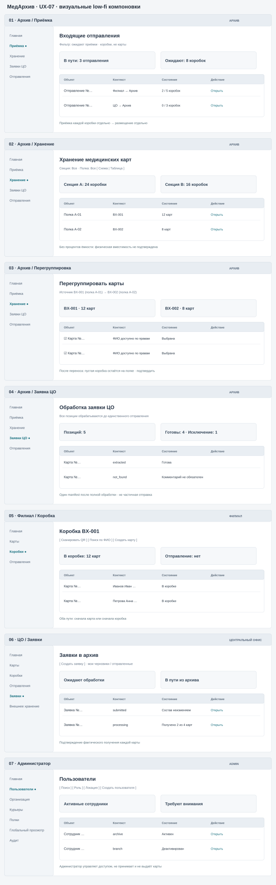

# UX-07 — визуальные low-fidelity компоновки основных рабочих экранов

**Дата:** 2026-11-23. **Статус:** визуальные схемы первого прохода для review; **не** интерактивный прототип, не production UI, не frontend-код.

[Открыть SVG-компоновки отдельно](assets/UX-07-VISUAL-LOWFI-ROLE-SCREENS.svg)

## Что показано

| Панель | Рабочее место | Ключевая задача | Основание |
|---|---|---|---|
| 01 | Архив — Приёмка | Найти входящее коробочное отправление, перейти к поштучной приёмке коробок | WF-A01…A03 |
| 02 | Архив — Хранение | Переключить визуальную схему и табличный реестр, открыть полку/коробку | WF-A04…A06, WF-M02…M04 |
| 03 | Архив — Перегруппировка | Выбрать карты из коробки на полке и переложить в другую, без перемещения коробок | WF-X07 |
| 04 | Архив — Заявка ЦО | Проверить результаты **всех** позиций до единственного fulfillment shipment | WF-A07…A10 |
| 05 | Филиал — Коробка | Добавить карту по QR/ФИО или создать прямо из коробки | WF-B02/B03 |
| 06 | ЦО — Заявки | Список заявок, доступ к карточке, последующее получение отдельных карт | WF-C01…C04 |
| 07 | Администратор — Пользователи | Управлять учётными записями без обычных операций с картами | WF-D01…D03 |

Данные, имена, идентификаторы, количества, статусы и расположение блоков на иллюстрациях **демонстрационные**. Не считать SVG изображением текущей реализации.

## Композиционные решения

1. **Общая рамка:** верхняя панель с контекстом роли; слева навигация только разрешённых разделов; в содержимом — заголовок, контекст, действия, фильтры, список и история.
2. **Приёмка:** счётчики — вход в конкретные очереди, не «статистика ради статистики»; реестр отправлений не раскрывает список карт внутри коробок; архив не видит ФИО курьера в основной шапке.
3. **Хранение:** визуальный и табличный режимы используют одинаковый серверный scope и фильтры. Пока нет инвентаризации вместимости, **нет процентов, свободных мест и рекомендаций о перегрузке**.
4. **Перегруппировка:** два объекта рядом для понятного сравнения «до/после»; показаны источник и цель, состав и отдельное подтверждение. Перенос карт не меняет размещение коробок. Если исходная коробка опустела, показать предупреждение и отдельное действие «Снять с полки», но не выполнять его автоматически.
5. **P-09:** архив сначала обрабатывает все позиции; только потом создаёт одно отправление. Получение ЦО по картам — отдельный экран и событие, а не частичная отправка.
6. **Филиал:** QR/сканирование и поиск по ФИО — отдельные варианты идентификации; ручного поиска по номеру/телефону нет. Создание карты из коробки возвращает пользователя к наполнению.
7. **Администратор:** глобальный просмотр и узкие корректировки не создают прав на обычные приёмку, упаковку и выдачу.

## Что проверять на следующем визуальном проходе

| Проверка | Критерий |
|---|---|
| Навигация | Сотрудник понимает, где «Приёмка», «Хранение», «Заявки»; нет одинаковых действий в нескольких основных пунктах |
| Главный сценарий | Основная кнопка не конкурирует с второстепенными; видно текущий объект и следующий шаг |
| Реестр → карточка → назад | Фильтры и контекст сохраняются; отдельные права на объект повторно проверяются |
| P-09 | «Все позиции обработаны» визуально предшествует «Создать отправление»; нет кнопки частичной отправки |
| X07 | Пользователь различает перенос карт и перемещение коробки; опустевшая коробка остаётся на полке |
| Доступность | Контраст, фокус, подписи полей, порядок табуляции, клавиатурное подтверждение и безопасные сообщения об ошибках — проверить на следующем макете |
| Адаптивность | На компактной ширине навигация сворачивается, таблица превращается в читаемый список или имеет управляемый горизонтальный скролл |
| Ошибки | «Нет данных», «Нет прав», «Ошибка загрузки», «Объект изменился» — разные состояния |

## Ограничения первого визуального прохода

- SVG — **статический обзор семи ключевых компоновок**. Не показывает все модальные окна, реальные формы, клавиатурный фокус, адаптивную ширину и все исключительные сценарии.
- Показаны примеры экранов **всех четырёх ролей**, но наиболее детально — архива, как ранее запланировано.
- Следующий проход UX-07: подробные визуальные состояния для **приёмки коробки**, **перегруппировки карт**, **P-09** и **компактной ширины**, затем единый product-review.
- UX-08 (интерактивный прототип) **не начат**. Код приложения, API, ORM, SQL, миграции, тесты и CI не менялись.

**Связанные документы:** `UX-07-UNIFIED-SCREEN-MAP-AND-NAVIGATION.md`, `UX-07-WF-01…WF-07`, `UX-07-CROSS-SCREEN-CONSISTENCY-REVIEW.md`.

## 2026-11-23 — изменение приоритета филиального экрана

По замечанию владельца продукта QR/HID — **главный, постоянно активный канал** филиала. На следующей визуальной итерации экран коробки обязан показывать «Сканер готов», текущую коробку, последний результат, счётчик, ошибки/очередь; кнопку «Сканировать» не делать обязательной для каждого считывания. Ручное создание/поиск — вторичные действия. См. `UX-07-WF-08-CONTINUOUS-QR-SCANNING.md`. Текущий SVG отражает прежний первый проход и **пока не является актуальной финальной компоновкой филиала**.
