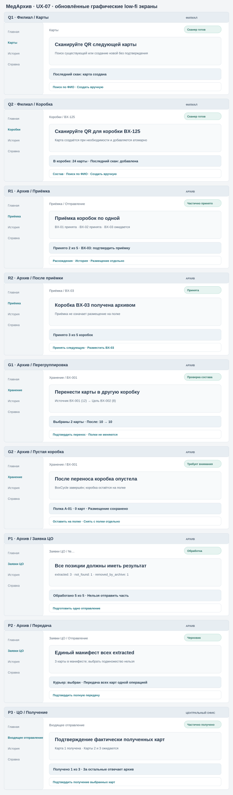

# UX-07 — графический обзор Q/R/G/P: девять детальных экранов

**Дата:** 2026-11-23. **Статус:** графический low-fi проход, не интерактивный прототип и не реализация.

[Открыть макеты SVG отдельно](assets/UX-07-VISUAL-LOWFI-DETAILED-FLOWS.svg)

## Сопоставление с утверждёнными процессами

| Макет | Источник требований | Ключевой инвариант |
|---|---|---|
| Q1 | WF-08 §6, QR Q1 | Непрерывный HID QR в разделе «Карты»; валидная новая карта создаётся без подтверждения |
| Q2 | WF-08 §6, QR Q2 | В открытой коробке новая карта создаётся и добавляется атомарно; текущая коробка видна |
| R1 | WF-02, R1 | Коробки принимаются по одной; без счёта карт/пломб |
| R2 | WF-02, R2 | Приёмка не размещает коробку автоматически |
| G1 | WF-X07, G1, DB-69 | Перенос выбранных карт из **одной** исходной коробки в целевую; placement не меняется |
| G2 | WF-X07, G2, DB-56/57/61 | Опустевшая коробка остаётся на полке; unplace — отдельная команда |
| P1 | WF-03, P1 | Результат по всем позициям до создания единственного отправления |
| P2 | WF-03, P2 | Все extracted входят в одно отправление; нельзя отправить подмножество |
| P3 | WF-03, P3 | ЦО подтверждает фактическое получение по картам; custody остальных остаётся архиву |

## Оценка композиции

Визуальные макеты показывают общий принцип: роль и объект сверху, локальная навигация слева, **одна главная рабочая область**, состояние справа, итог последней операции и действия ниже. Ручные способы в Q1/Q2 вторичны по отношению к постоянно готовому QR.

### Чего графические макеты пока не доказывают

- Фактическую работу HID-сканера и корректность фокуса/очереди: проверять на UX-08 и в реализации.
- Реальную клавиатурную доступность, контраст на целевых устройствах и адаптивное поведение.
- Полноту интерактивных состояний конфликтов, ошибочной приёмки и обработки исключений; текстовые Q3/Q4, R3 и другие состояния остаются нормативным дополнением.
- Правильность PostgreSQL-транзакций: это задача будущих DB-контрактов и тестов.
- Многоисточниковый атомарный repack: DB-69 не позволяет объявить его разрешённым без технической сверки.

## Product-review: итоговая контрольная таблица

| Проверка | Результат документальной проверки | Следующий этап |
|---|---|---|
| Основные задачи филиала и приоритет QR | Отражены Q1/Q2 | Интерактивный UX-08 |
| Приёмка ≠ размещение | Отражено R1/R2 | Интерактивный UX-08 |
| Перегруппировка на полках | Отражено G1/G2 | Интерактивный UX-08; DB-69 gate перед реализацией |
| Одно полное P-09 отправление | Отражено P1/P2 | Интерактивный UX-08 |
| Частичное получение ЦО | Отражено P3 | Интерактивный UX-08 |
| Ошибки и конфликты | Текстовые Q/R/G/P схемы и матрицы | Интерактивный UX-08 |
| Все четыре роли, три маршрута | Проверено в `UX-07-FINAL-CONSISTENCY-AND-UX08-READINESS-REVIEW.md` | Проверка переходов в UX-08 |
| Адаптивность и доступность | Только проектные критерии | Интерактивный UX-08 |

**Предлагаемый выход UX-07:** документальная полнота и основной графический low-fi проход достигнуты. Для формального закрытия требуется **подтверждение владельцем продукта итогового набора**. Не считать UX-08 начатым до такого подтверждения. Код приложения, API, ORM, миграции и тесты не менялись.

## 2026-11-23 — итоговое утверждение владельцем продукта

**UX-07 утверждён владельцем продукта и закрыт по документально-визуальному критерию.** Утверждены ранее подготовленные WF-01…WF-08, low-fi визуальные макеты, единая карта экранов и зафиксированные ограничения. Открытый технический gate DB-69/multi-source repack **не означает** разрешение массового извлечения и переносится в техническую сверку до UX-10. HID/адаптивность/клавиатурная доступность требуют проверки на UX-08. Разрешён переход к **UX-08 — интерактивным прототипам**. Не разрешена реализация production-приложения, ORM, API, миграций или тестов.
