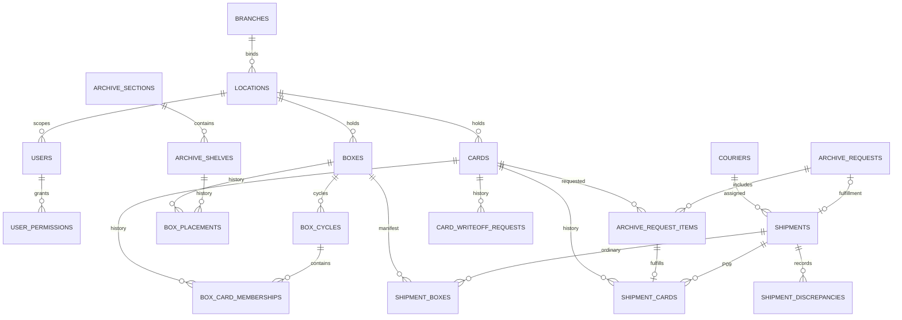

# UX-09.5C — target relational model
2026-11-26. Owner confirmed service never entered production and no real SQLite data exists. No SQLite conversion or compatibility required. PostgreSQL environment data not independently verified; no destructive reset authorized. Preserve Alembic chain and reproducible clean install.
Sources: UX-06-TECHNICAL-DATA-MODEL §§3–4 and later decisions, UX-08-06-CUSTODY-REPRESENTATION-PROPOSAL, UX-09-04 cross-contract review, UX-09-05A/B. Logical schema proposal, not executable DDL.
## Relations and fields
UUID PK unless composite indicated; timestamps timestamptz; actor FK users RESTRICT; historical references RESTRICT. Existing fields retained unless explicitly retired after dependency review.
| Relation | Key target fields / relations |
|---|---|
| branches | id, name, active; existing identity |
| locations | id, kind, branch_id, active; branch/CO/archive only |
| users | id, login unique immutable, full_name, password_hash, role, location binding, active, session_version (proposed) |
| couriers | id, full_name, normalized_name unique, active; retire phone |
| user_permissions | user_id, permission_code composite PK, granted_by, granted_at; current grants, history in audit |
| cards | id, card_number unique, full_name, birth_date, phone nullable, origin_branch_id, status, current_location_id/current_shipment_id, external custody fields, created_by/time |
| boxes | id, box_number unique, status, current_location_id/current_shipment_id, created_by/time |
| box_cycles | id, box_id, opened_at/by, closed_at/by |
| box_card_memberships | id, cycle_id, card_id, added_at/by, removed_at/by |
| archive_sections | id, name, active (proposed normalization) |
| archive_shelves | id, section_id, name, active; existing QR identity review |
| box_placements | id, box_id, shelf_id, placed_at/by, ended_at/by |
| archive_requests | id, requested_by, status, created/updated/submitted/processing/completed/cancelled timestamps, processing/cancel actors, cancellation_reason |
| archive_request_items | id, request_id, card_id, status, reservation_active, added/extracted/resolved actors/times, reason_code, comment, source/returned_membership_id |
| shipments | id, source/destination location, request_id nullable UNIQUE, status, author, courier_id, courier_name_snapshot, handover/receipt/cancel metadata |
| shipment_boxes | shipment_id+box_id PK, cycle_id snapshot reference (proposed), received_at/by; correction fact model pending |
| shipment_cards | shipment_id+card_id PK, request_item_id UNIQUE NOT NULL for new P09, received_at/by; legacy box_id retired after reconciliation |
| shipment_discrepancies | id, shipment_id, kind, expected/observed box reference nullable, recorded_at/by, resolution metadata; exact outcomes pending |
| card_writeoff_requests | id, card_id, requested_by, status, reason_code, optional comment/document metadata, processing/execution/rejection/cancel actors/times/reasons; exact status vocabulary verify G |
| domain_events | id, aggregate type/id, event_type, actor, occurred_at, typed versioned payload, correlation_id |
| admin_security_audit | id, event_type, actor/target references as allowed, occurred_at, outcome, typed payload, correlation_id |
| command_ledger | command_id PK, actor, command_type, input fingerprint, versioned result envelope, correlation_id, completed_at |
| auth_login_throttles | existing migration-managed relation; preserve privacy/security contract |
Logical inventory 23 relations; optional session/reason/receipt correction relations not yet selected. card_placements retired from active model; historical data handling depends on PG preflight.
## ER diagram

## Key engineering selections
Prefer shipments.request_id nullable UNIQUE as single authoritative parent link; reverse relationship queried, retire redundant parent FK only after migration. UNIQUE request_item_id and composite manifest PK; never global UNIQUE card_id across historical shipments. reservation_active partial unique card_id, maintained transactionally through parent completion/cancellation including exceptions. Parent statuses draft/submitted/processing/completed/cancelled; item statuses per UX06 §3.2. P09 all extracted items immutable in one draft, no subset, one handover, per-item receipt. Ordinary manifests only boxes; derive contents from frozen membership/cycle, historical snapshots as required. No new ordinary ShipmentCard rows. Ordinary partial receipt status representation pending T04; do not silently extend P09-only enum semantics.
Custody proposal: derive accountable location for stationary object, courier from immutable handed-over shipment and unreceived item/box for transit. Separate external custody status, CO remains accountable. No duplicate courier FK on card. Explicit custodian discriminator alternative if exception/restore tests show need. Not_found physical absence is not fictitious shelf/location; distinguish accounting location and known physical placement. Current location/shipment XOR and legacy card manifest FK require replacement guard; exact physical pointer strategy pending 5D. 
Card number correction authority resolved R04 by explicit UX06 decision 2026-11-22: all active admins inherent, not grant. Restore active without automatic location/custody change. Separate permission codes for other grants verified before DDL. No patient entity, courier role, direct branch↔CO, direct shelf card placement. No new business decisions. 
## Open
Exact SQL types/lengths, status and reason catalogs, receipt correction append-only facts, discrepancy outcomes, scope and custody exception matrix, session version vs session registry, audit retention, DB69 and effective trigger dependencies. 5D constraints/commands; 5E migrations; 5F PG preflight (SQLite transfer excluded); 5G retirement. No source/DDL/HTML changes; no tests.
